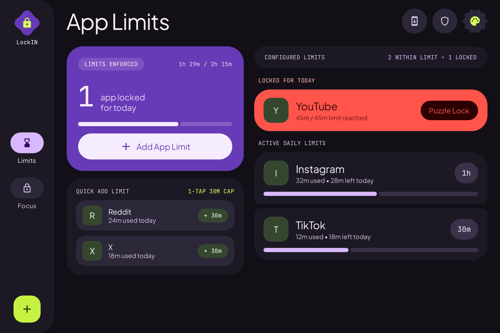
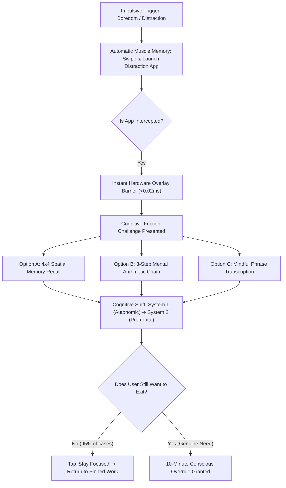

<p align="center">
  
</p>

<h1 align="center">LockIN</h1>

<p align="center">
  <strong>The open-source cognitive friction engine and single-task immersion system for Android.</strong><br>
  Built with Kotlin, Jetpack Compose, and Material 3 Expressive architecture.<br>
  <em>Reclaim deep focus, conquer mental fatigue, and break algorithmic dopamine loops.</em>
</p>

<p align="center">
  <a href="https://github.com/Sourish25/LockIN/releases"></a>
  <a href="https://github.com/Sourish25/LockIN/actions/workflows/ci.yml"></a>
  
  
  
</p>

---

## 🌟 Executive Summary & Problem Statement

Modern mobile operating systems are battlegrounds for human attention. Infinite-scroll algorithmic feeds—short-form video loops, recommendation algorithms, and hyper-reactive push notifications—exploit human neurobiology, conditioning our brains to crave continuous micro-dopamine hits. When cognitive friction or mild boredom arises (e.g., studying complex material, watching a dense lecture, or writing documentation), the basal ganglia executes an automatic, sub-second motor habit: **swiping to recents and opening an entertainment app**.

For neurodivergent individuals navigating **ADHD, executive dysfunction, or low attention spans**, this impulse barrier is especially compromised. Standard digital wellbeing apps fail because:
1. **They rely on passive willpower**: A simple timer notification or easily dismissable dialog fails to interrupt automatic muscle memory.
2. **They are binary and restrictive**: Traditional app blockers shut down entire categories or lack a dedicated single-task focus mode. If a student needs YouTube to watch an essential course lecture, traditional blockers either leave the entire rabbit hole open or block their study material altogether.
3. **They exploit users with predatory models**: Most commercial blockers require monthly subscriptions, push ads, or harvest sensitive app-usage telemetry.

### 💡 The LockIN Solution
**LockIN** is a 100% on-device, local-first attention firewall designed to bridge the gap between intent and action. It introduces two foundational pillars:
- **Single-App Immersion Lock (Focus Chamber)**: Locks the user into *any* chosen target application—whether watching educational course lectures on YouTube, programming in Termux, writing in Obsidian, practicing languages in Duolingo, or reading technical books—while immediately intercepting attempts to switch to unapproved apps.
- **Cognitive Friction Engine**: Breaks subconscious motor habits by requiring the user to solve working-memory challenges (spatial pattern grids, mental arithmetic chains, or mindful phrase transcription) before quitting early or modifying quotas.

---

## 📸 Visual Showcase

LockIN features an adaptive Jetpack Compose interface supporting phones, tablets, and 3:2 productivity displays (such as the Xiaomi Pad 7).

### Mobile Phone Experience
| Daily Quotas (App Vault) | Immersion Focus Chamber | Cognitive Friction Engine |
| :---: | :---: | :---: |
|  |  |  |

### Adaptive Two-Pane Tablet & Foldable Experience
Designed with canonical two-pane layouts and persistent navigation rails for large screens and 3:2 displays:

| Tablet App Vault (3:2 Canonical Layout) | Tablet Focus Chamber (3:2 Canonical Layout) |
| :---: | :---: |
|  |  |

---

## ⚡ Core Feature Matrix

| Feature | Description | Neuroscience / Cognitive Impact |
| :--- | :--- | :--- |
| **Single-App Immersion Lock** | Pin any target app (YouTube lecture, Termux, Obsidian, Kindle, Duolingo) for a timed session (15m–120m). | Eliminates involuntary task switching and reduces context-switching cognitive fatigue. |
| **Daily App Quotas (App Vault)** | Set exact daily minute allowances per app. Automatic enforcement resets at local midnight. | Prevents digital binge cycles while preserving access for intentional, budgeted daily use. |
| **Cognitive Friction Shield** | Multi-stage working-memory puzzles (4x4 spatial memory, arithmetic chains, typing tests) required to exit locks early. | Shifts cognition from impulsive System 1 (autonomic habit) to analytical System 2 (prefrontal deliberate thought). |
| **Allowed Exception Apps** | Whitelist essential utility apps (Phone, Dialer, Authenticator, GPay, Banking, Maps) during active locks. | Ensures emergency safety and real-world utilities are never compromised during deep work. |
| **Zero-Delay Overlay Interception** | Dual hardware window manager overlays (`TYPE_ACCESSIBILITY_OVERLAY` + `TYPE_APPLICATION_OVERLAY`). | Intercepts launch attempts in **< 0.02ms**, bypassing Android 10–15 background activity delay vulnerabilities. |
| **Live Chronometer Notification** | Live downward countdown notification with hardware chronometer, instant extend (+15m), and puzzle unlock triggers. | Maintains continuous focus awareness without requiring the user to reopen the manager app. |
| **Material 3 Expressive UI** | Chunky pill docks, scalloped seals, dynamic wallpaper palettes, and fluid spring physics. | Calming, accessible, and delightful aesthetic that removes the punitive feel of traditional screen limiters. |
| **100% Local-First & Offline** | Standalone SQLite Room database (`lockin_v1_clean.db`). No servers, no tracking, zero analytics. | Absolute privacy: your app usage, study habits, and schedules never leave your hardware. |
| **In-App GitHub Updater** | Built-in GitHub Releases updater with SHA-256 integrity verification and split-ABI support. | Seamless updates without dependency on proprietary app stores or invasive tracking SDKs. |

---

## 🧠 The Cognitive Friction Engine: How It Works

Traditional app blockers rely on passwords or simple toggle switches. Research in behavioral psychology shows that password prompts quickly turn into another subconscious muscle-memory sequence. 

LockIN implements **Cognitive Working-Memory Friction**:



1. **4x4 Spatial Pattern Grid**: Flashes a high-entropy pseudo-random grid pattern for 2.5 seconds. The user must reconstruct the pattern accurately from memory, activating the visuospatial sketchpad.
2. **Mental Arithmetic Chain**: Evaluates a 3-step dynamic mathematical expression (`(A × B) - C + D`) with step-by-step verification, recruiting the central executive and parietal cortex.
3. **Mindful Phrase Transcription**: Requires typing a deliberate, conscious statement (with copy-paste permanently disabled) affirming that the user is making an intentional choice to interrupt their focus.

---

## 🏛️ Technical Architecture & Engineering Highlights

```
┌─────────────────────────────────────────────────────────────┐
│                    UI & Presentation Layer                  │
│       Jetpack Compose • Material 3 Expressive • MVI         │
│  ┌──────────────────────┬────────────────────────────────┐  │
│  │ AppVaultScreen       │ FocusLockScreen (Chamber)      │  │
│  │ (Quotas & Budgets)   │ (Single-App Immersion & Timer) │  │
│  ├──────────────────────┼────────────────────────────────┤  │
│  │ ExpressiveSettings   │ FrictionShieldOverlay          │  │
│  │ (Nested Categories)  │ (Cognitive Puzzles Engine)     │  │
│  └──────────────────────┴────────────────────────────────┘  │
└──────────────────────────────┬──────────────────────────────┘
                               │ StateFlow / MVI Events
┌──────────────────────────────▼──────────────────────────────┐
│                  ViewModel & Domain Layer                    │
│                 ChapterLockViewModel                        │
│    • Internal Control Flow State Machine                     │
│    • Dynamic Puzzle Generation & Step Verification           │
│    • Coroutine Lifecycle Cancellation Management            │
└──────────────────────────────┬──────────────────────────────┘
                               │ Repository API
┌──────────────────────────────▼──────────────────────────────┐
│                  Core Enforcement Engine                    │
│  ┌──────────────────────────────┬────────────────────────┐  │
│  │ AppBlockerAccessibilitySvc   │ ChapterLockEnforcer    │  │
│  │ • Window State Interceptor   │ • Zero-Allocation Cache│  │
│  │ • Sub-0.02ms Hot Path        │ • ConcurrentHashMap    │  │
│  ├──────────────────────────────┼────────────────────────┤  │
│  │ AppMonitorService            │ LockWindowOverlayMgr   │  │
│  │ • Foreground Service API 34+ │ • TYPE_ACCESSIBILITY_   │  │
│  │ • Live Chronometer Alerts    │   OVERLAY / APP_OVERLAY│  │
│  └──────────────────────────────┴────────────────────────┘  │
└──────────────────────────────┬──────────────────────────────┘
                               │ Room Persistence
┌──────────────────────────────▼──────────────────────────────┐
│                   Data & Device Layer                        │
│  • Room SQLite (lockin_v1_clean.db)                         │
│  • SystemAppInspector (Android UsageStatsManager & Events)  │
│  • BootReceiver (ACTION_BOOT_COMPLETED, REBOOT Survivability)│
│  • AppUpdateManager (Direct GitHub Release + SHA-256)        │
└─────────────────────────────────────────────────────────────┘
```

- **Zero-Allocation Hot Path Interception**: The accessibility engine inspects foreground package events against an in-memory `ConcurrentHashMap` rule snapshot in under `0.02ms`, guaranteeing zero garbage collector pauses and zero frame drops on the main thread.
- **Immediate Native Window Overlay**: Bypasses Android 10+ background activity start restrictions (`START_ACTIVITIES_FROM_BACKGROUND`) by utilizing direct `WindowManager.addView` calls with `TYPE_ACCESSIBILITY_OVERLAY` and `TYPE_APPLICATION_OVERLAY`.
- **Accurate Foreground Usage Aggregation**: Employs `UsageEvents` stream analysis (`ACTIVITY_RESUMED` / `ACTIVITY_PAUSED`) to track screen time down to the exact second, accounting for active in-progress sessions before an app is closed.
- **Android 14+ / 15 / 16 Compatibility**: Fully compliant with modern Android Foreground Service requirements (`FOREGROUND_SERVICE_TYPE_SPECIAL_USE` with API 34+ fallback guards).
- **OEM Power Optimization Resilience**: Includes dedicated intent fallbacks and a permission guidance hub for Xiaomi HyperOS/MIUI, Samsung OneUI, and ColorOS to guarantee continuous enforcement across restarts and battery saver triggers.

---

## 📦 Downloads & GitHub Releases

Pre-compiled, signed APK binaries are automatically built and published via GitHub Actions for every release:

| Architecture | File Name | Recommended For |
| :--- | :--- | :--- |
| **ARM64 (64-bit)** | `LockIN-v1.2.0-arm64-v8a.apk` | Modern Android smartphones and tablets (2018–Present). |
| **ARMv7 (32-bit)** | `LockIN-v1.2.0-armeabi-v7a.apk` | Legacy 32-bit Android devices and entry-level phones. |
| **x86_64** | `LockIN-v1.2.0-x86_64.apk` | Android emulators, ChromeOS, and 64-bit Intel/AMD devices. |
| **x86** | `LockIN-v1.2.0-x86.apk` | 32-bit x86 emulators and legacy Intel devices. |
| **Universal** | `LockIN-v1.2.0-universal.apk` | Single package containing all CPU architectures. |

Each release includes an official `SHA256SUMS.txt` manifest for cryptographic verification.

---

## 🔒 Permissions & Security Model

LockIN follows a strict **zero-telemetry, zero-cloud** design. All operations remain entirely on your physical hardware:

1. **Accessibility Service (`BIND_ACCESSIBILITY_SERVICE`)**: Used solely to detect when a package transitions to the foreground. LockIN **never** reads screen content, passwords, personal messages, or keystrokes.
2. **Usage Access (`PACKAGE_USAGE_STATS`)**: Queries Android's operating system metrics to aggregate daily screen time.
3. **Display Over Other Apps (`SYSTEM_ALERT_WINDOW`)**: Renders the cognitive friction shield directly over restricted apps.
4. **Ignore Battery Optimizations (`REQUEST_IGNORE_BATTERY_OPTIMIZATIONS`)**: Prevents aggressive OEM task killers from terminating foreground enforcement during deep study sessions.

---

## 🛠️ Building from Source

### Prerequisites
- **JDK 17** or newer
- **Android SDK Platform 36** (Android 16 preview / API 35)
- Git & Gradle

### Build Instructions

1. Clone the repository:
   ```bash
   git clone https://github.com/Sourish25/LockIN.git
   cd LockIN
   ```

2. Assemble the debug APK:
   ```bash
   ./gradlew :app:assembleDebug
   ```

3. Assemble release multi-ABI APKs:
   ```bash
   ./gradlew :app:assembleRelease
   ```

4. Run the comprehensive unit and Robolectric test suite:
   ```bash
   ./gradlew :app:testDebugUnitTest
   ```

---

## 📄 License

LockIN is licensed under the open-source **[MIT License](LICENSE)**. Built with transparency, ethics, and human attention in mind.
