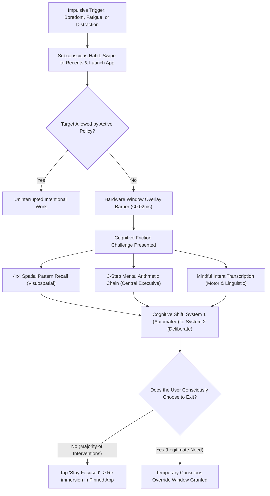
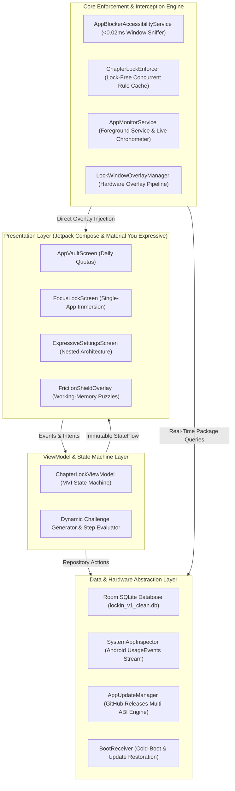

<p align="center">
  
</p>

<h1 align="center">LockIN</h1>

<p align="center">
  <strong>On-Device Cognitive Friction Engine and Single-Task Immersion Platform for Android</strong><br>
  Engineered with Kotlin, Jetpack Compose, and Material You Expressive design principles.<br>
  Interrupt algorithmic dopamine loops, conquer executive dysfunction, and cultivate sustainable deep focus.
</p>

<p align="center">
  <a href="https://github.com/Sourish25/LockIN/releases"></a>
  <a href="https://github.com/Sourish25/LockIN/actions"></a>
  
  
  
  
  <a href="LICENSE"></a>
</p>

---

## Executive Overview

Modern mobile interfaces are heavily optimized for continuous engagement. Infinite-scroll content feeds, algorithmic recommendations, and high-frequency push notifications exploit human dopaminergic pathways, conditioning users toward continuous task-switching and micro-distraction. When cognitive friction, mental resistance, or fatigue emerges during demanding activities—such as digesting technical lecture material, writing code, studying research papers, or practicing a language—the basal ganglia initiates automated motor habits: swiping into recent apps and opening an entertainment feed before conscious intent can intervene.

For neurodivergent individuals navigating Attention Deficit Hyperactivity Disorder (ADHD), low attention span, or executive dysfunction, this impulse threshold is especially difficult to navigate. Existing digital wellbeing tools exhibit three core structural weaknesses:

1. **Reliance on Passive Willpower**: Standard countdown reminders and easily dismissed dialogs fail to interrupt ingrained physical motor patterns.
2. **Binary and Coarse-Grained Controls**: Generic blockers disable applications globally. If a student requires YouTube for an essential academic lecture, existing software either permits access to the full recommendation engine or blocks educational material altogether.
3. **Surveillance and Monetization Overload**: Many consumer screen-time applications rely on subscription paywalls, third-party advertising, and invasive cloud telemetry that tracks user application usage.

### The LockIN Architecture

LockIN provides a local-first, zero-telemetry cognitive firewall that operates directly on device hardware. The platform is anchored by two complementary mechanisms:

- **Single-App Immersion (Focus Chamber)**: Grants intentional, timed access to a single target application—ranging from video lectures and terminal environments to note-taking suites and reading tools—while immediately intercepting any attempt to navigate toward unapproved applications.
- **Cognitive Friction Shield**: Inserts deliberate prefrontal working-memory challenges (spatial pattern reconstruction, multi-step mental arithmetic, or mindful phrase transcription) into impulsive exit attempts. This converts automatic motor impulses into deliberate conscious decisions.

---

## Material You Expressive Design System

LockIN is built upon the Material You Expressive design language, moving beyond traditional flat layouts to deliver a tactile, emotionally resonant, and modern user experience. The interface balances high-density utility with calming visual rhythm.

### Design Principles

```
  Geometric Whimsy        Dynamic Fluidity         Tactile Feedback        Adaptive Canvases
 ┌────────────────┐      ┌────────────────┐      ┌────────────────┐      ┌────────────────┐
 │ Scalloped seals│      │ Slot-machine   │      │ Synthesized    │      │ Canonical      │
 │ & chunky pill  │ ───> │ odometer clock │ ───> │ micro-haptics  │ ───> │ two-pane 3:2   │
 │ touch targets  │      │ transitions    │      │ & audio cues   │      │ tablet layouts │
 └────────────────┘      └────────────────┘      └────────────────┘      └────────────────┘
```

- **Expressive Geometric Shapes**: Custom 8-point and 12-point scalloped seal containers (`ExpressiveSealShape`), asymmetrical squircle cards (`ExpressiveSquircleShape`), and floating floating pill docks anchor navigation.
- **Slot-Machine Odometer Chronometer**: Time selections and active session countdowns feature vertical digit rolling transitions, providing clear physical feedback as duration changes.
- **Kinetic Particle Interception**: Application violations trigger an immediate 60fps hardware-accelerated geometric red cross rain canvas, reinforcing boundary awareness without punitive messaging.
- **Multi-Sensory Micro-Feedback**: Custom haptic waveforms paired with zero-latency synthesized audio provide tactile feedback for picker steps, lock engagements, and puzzle milestones.
- **Adaptive Screen Architecture**: Dynamic window-size class handling scales seamlessly across compact smartphones, foldables, and large-screen tablets (including 3:2 productivity displays such as the Xiaomi Pad 7).

---

## Visual Interface

### Mobile Phone Layouts

| Daily Quotas (App Vault) | Immersion Focus Chamber | Cognitive Friction Engine |
| :---: | :---: | :---: |
|  |  |  |

### Adaptive Two-Pane Tablet & Large-Screen Layouts

Optimized for horizontal and 3:2 canvas geometries with persistent navigation rails, balanced content panes, and dedicated master-detail inspectors.

| Tablet App Vault (3:2 Canonical Layout) | Tablet Focus Chamber (3:2 Canonical Layout) |
| :---: | :---: |
|  |  |

---

## Cognitive Friction Engine

Standard application blockers rely on PIN codes, which quickly degrade into sub-second muscle memory. LockIN replaces static gates with dynamic working-memory challenges designed to stimulate the prefrontal cortex and deactivate automatic impulse loops.

### Cognitive Decision Flow



### Challenge Modalities

1. **4x4 Spatial Working-Memory Grid**: Generates high-entropy pseudo-random tile sequences. The user observes the illuminated pattern for 2.5 seconds and must reproduce the coordinates in sequence, recruiting the visuospatial sketchpad.
2. **Mental Arithmetic Chain**: Evaluates dynamic multi-operand mathematical equations across sequential input steps, requiring sustained engagement from the central executive and parietal networks.
3. **Mindful Intent Transcription**: Presents deliberate contextual affirmations regarding focus commitment. System paste actions and clipboard shortcuts are isolated to ensure manual, mindful keystrokes.

---

## Technical Architecture

LockIN uses a layered, unidirectional Model-View-Intent (MVI) architecture powered by Kotlin Coroutines, StateFlow streams, and Room SQLite persistence.



### Engineering Highlights

- **Sub-0.02ms Hot-Path Interception**: The accessibility engine matches incoming window transition events against an in-memory `ConcurrentHashMap` rule cache in under `0.02ms`, avoiding memory allocations and eliminating garbage collection latency on the main UI thread.
- **Dual-Layer Hardware Overlay Architecture**: Combines `TYPE_ACCESSIBILITY_OVERLAY` and `TYPE_APPLICATION_OVERLAY` through direct `WindowManager.addView` invocations. This bypasses Android 10+ background activity start restrictions (`START_ACTIVITIES_FROM_BACKGROUND`) and prevents screen flicker.
- **Second-Accurate Usage Aggregation**: Inspects Android `UsageEvents` stream deltas (`ACTIVITY_RESUMED` / `ACTIVITY_PAUSED`) to track cumulative foreground duration accurately down to the second, including sessions currently in progress.
- **Android 14 to 16 API Compliance**: Fully conforms to modern Android Foreground Service requirements (`FOREGROUND_SERVICE_TYPE_SPECIAL_USE` with API 34+ property declarations and fallback guards).
- **In-App Split-ABI Engine**: Features an integrated GitHub Releases updater that evaluates asset ISO-8601 timestamps, downloads native ABI-matched packages, verifies SHA-256 cryptographic checksums, and coordinates `FileProvider` package installs.

---

## Feature Comparison

| Capability | LockIN | Standard Wellbeing Apps | Commercial Focus Apps |
| :--- | :--- | :--- | :--- |
| **Single-App Immersion Lock** | Yes (Pin any application) | No | Limited |
| **Cognitive Friction Challenges** | Yes (Multi-stage working memory) | No | Simple math or password |
| **Hardware Overlay Interception** | Yes (<0.02ms latency) | No (Notifications only) | Delayed activity launch |
| **Allowed Utility Exceptions** | Yes (Phone, Maps, Banking) | No | Rarely supported |
| **Data Privacy & Telemetry** | 100% On-Device (Zero Telemetry) | Cloud Sync Required | Proprietary Analytics |
| **Software Pricing Model** | Free & Open Source (MIT) | Free (Platform locked) | Monthly Subscriptions |
| **Material You Expressive UI** | Yes (Custom shapes, physics) | Standard Material 3 | Generic Webviews |
| **Offline Autonomous Operation** | Yes (No internet required) | Varies | No (Requires login) |

---

## Release Packages & Multi-ABI Distribution

Production-ready release builds are compiled, signed, and published directly through GitHub Actions for each release:

| Architecture | Package Asset | Target Hardware |
| :--- | :--- | :--- |
| **ARM64 (64-bit)** | `LockIN-v1.2.0-arm64-v8a.apk` | Modern Android smartphones and tablets (2018–Present) |
| **ARMv7 (32-bit)** | `LockIN-v1.2.0-armeabi-v7a.apk` | Legacy 32-bit Android devices and entry-tier hardware |
| **x86_64** | `LockIN-v1.2.0-x86_64.apk` | Modern desktop Android emulators, ChromeOS, and 64-bit Intel/AMD |
| **x86** | `LockIN-v1.2.0-x86.apk` | 32-bit development emulators |
| **Universal** | `LockIN-v1.2.0-universal.apk` | Single unified distribution supporting all architectures |

Every release includes an official `SHA256SUMS.txt` cryptographic manifest to verify archive authenticity prior to installation.

---

## Security & Permission Model

LockIN adheres to a strict least-privilege architecture. The application contains zero network analytics trackers, zero advertising SDKs, and zero cloud synchronization endpoints:

| Permission | Technical Requirement | Scope & User Protection |
| :--- | :--- | :--- |
| `BIND_ACCESSIBILITY_SERVICE` | Detect foreground window package transitions. | Strictly restricted to window state changes. LockIN never inspects screen text, user input, account credentials, or notifications. |
| `PACKAGE_USAGE_STATS` | Aggregate accurate daily foreground screen duration. | Read-only aggregation of daily application usage metrics stored locally on device storage. |
| `SYSTEM_ALERT_WINDOW` | Render cognitive friction puzzles over restricted apps. | Used solely to display the focus barrier when an unauthorized application transition occurs. |
| `FOREGROUND_SERVICE` | Maintain background enforcement during active timers. | Keeps the countdown timer active and presents real-time chronometer notifications. |
| `REQUEST_IGNORE_BATTERY_OPTIMIZATIONS` | Prevent OEM background process termination. | Ensures steady focus tracking across aggressive OEM task killers (MIUI, HyperOS, OneUI). |

---

## Building from Source

### Prerequisites

- **Java Development Kit (JDK)**: Version 17 or higher
- **Android SDK**: Compile SDK 36 (Android 16 preview / API 35 compatible)
- **Build Tools**: Gradle 8.13+, Android Gradle Plugin 8.9+
- **Git**

### Compilation Steps

1. Clone the repository:
   ```bash
   git clone https://github.com/Sourish25/LockIN.git
   cd LockIN
   ```

2. Assemble the debug binary:
   ```bash
   ./gradlew :app:assembleDebug
   ```

3. Assemble release multi-ABI application packages:
   ```bash
   ./gradlew :app:assembleRelease
   ```

4. Execute the unit test suite and Robolectric test harness:
   ```bash
   ./gradlew :app:testDebugUnitTest
   ```

---

## License

LockIN is distributed under the terms of the **[MIT License](LICENSE)**. Built with transparency, technical rigor, and digital autonomy in mind.
