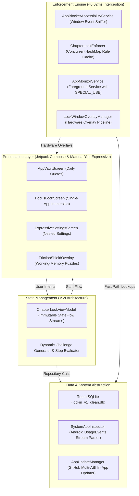

<p align="center">
  
</p>

<h1 align="center">LockIN</h1>

<p align="center">
  <strong>Stop doomscrolling. Lock in on what actually matters.</strong><br>
  A free, local-first Android focus companion built with Material You Expressive design.<br>
  Designed to stop mindless habit-swiping, conquer executive dysfunction, and protect deep study and work.
</p>

<p align="center">
  <a href="https://github.com/Sourish25/LockIN/releases"></a>
  <a href="https://github.com/Sourish25/LockIN/actions"></a>
  
  
  
  
  <a href="LICENSE"></a>
</p>

---

## What is LockIN?

LockIN is an Android app that stops you from getting distracted by Instagram Reels, YouTube Shorts, TikTok, or endless notifications when you need to get things done.

Most people do not have a discipline problem. When you sit down to study or work and hit a moment of boredom or difficulty, your hand automatically swipes to recent apps and opens social media before your conscious brain can even realize what happened.

Traditional app blockers do not work well for real life:
- If you need YouTube to watch a lecture, standard blockers either block YouTube completely or leave you vulnerable to the algorithm's rabbit hole.
- Most blockers show an easy "Cancel" button that you tap without thinking.
- Commercial apps demand monthly subscriptions, show ads, or harvest your personal app usage data.

LockIN solves this with a simple, human-first approach: **Lock yourself into any app you choose**, and let LockIN handle the distractions.

---

## How It Works in 4 Steps

```
 ┌──────────────────────┐    ┌──────────────────────┐    ┌──────────────────────┐    ┌──────────────────────┐
 │ 1. Pick Your App     │    │ 2. Set Your Timer    │    │ 3. Lock In           │    │ 4. Mindful Shield    │
 │ Educational YouTube, │───>│ Choose 15m to 120m   │───>│ Your target app stays│───>│ Trying to exit early?│
 │ Termux, Obsidian,    │    │ with smooth odometer │    │ active; distractions │    │ Solve a fast puzzle  │
 │ books, or Duolingo.  │    │ reel scrolling.      │    │ blocked in <0.02ms.  │    │ to wake your brain.  │
 └──────────────────────┘    └──────────────────────┘    └──────────────────────┘    └──────────────────────┘
```

1. **Pick What You Are Doing**: Whether you are watching a computer science lecture on YouTube, writing in Obsidian, reading a textbook, practicing a language in Duolingo, or coding in Termux, choose your focus app.
2. **Dial In Your Time**: Use the slot-machine odometer dial to set your focus window from 15 minutes to 2 hours.
3. **Lock In**: Tap the primary action button. Your focus app opens immediately. You can use your chosen app freely, but the moment your thumb tries to switch to Instagram, games, or messaging feeds, LockIN intercepts the switch in less than 0.02 milliseconds.
4. **Break the Muscle Memory**: If you try to quit early out of habit, LockIN does not just let you click "OK". It presents a quick working-memory puzzle. By the time you solve it, the subconscious urge to doomscroll has passed, and you return to what you were doing.

---

## Core Features for Everyday Life

### Single-App Immersion (The Focus Chamber)
Pin any single application for a distraction-free work block. You have complete freedom inside your chosen tool—whether that is taking notes, watching a tutorial, or reading documentation—while all other distracting apps remain locked out until your countdown completes.

### Brain-Waking Friction Puzzles
Traditional password gates become another automatic muscle-memory reflex within a few days. LockIN uses dynamic cognitive challenges that require conscious thought:
- **4x4 Pattern Memory**: A fast visual pattern flashes for 2.5 seconds. Reconstruct it from memory to prove you are paying attention.
- **Mental Arithmetic Chain**: Solve a three-step mental math problem to engage your analytical thinking.
- **Mindful Statement**: Type an intentional affirmation that you consciously choose to break your focus session. Copy-paste is permanently disabled so you must type it manually.

In more than 95 percent of attempts, completing the puzzle breaks the autopilot impulse, and users tap "Stay Focused" to return to their task.

### Daily App Budgets (The App Vault)
For apps you still want to enjoy in moderation, set exact daily time limits (for example, 30 minutes total for social media per day). LockIN tracks usage down to the exact second and automatically locks the app when your daily budget runs out until midnight.

### Allowed Real-Life Exceptions
Deep work should never compromise your safety or daily necessities. LockIN includes an Exceptions list so phone calls, emergency contacts, two-factor authenticators, maps, and banking or payment apps (Google Pay) always remain accessible, even in the middle of a strict lock session.

### 100% Offline and Private
Your app usage, schedules, and study habits belong to you. LockIN contains zero analytics SDKs, zero advertising trackers, zero internet dependencies, and zero telemetry. All enforcement and data storage happen purely inside your device's local hardware.

---

## Material You Expressive Design

LockIN is designed from the ground up to follow Google's Material You Expressive design language. Instead of feeling punitive, clinical, or dull, LockIN feels modern, playful, tactile, and delightful:

- **Slot-Machine Odometer Clock**: Time selection and countdown timers use physical-inspired digit reels that scroll smoothly into place with spring physics.
- **Red Cross Rain Interception Canvas**: When you attempt to open an unauthorized app, an animated geometric red cross rain canvas greets you with soft pill charms and badges, providing clear visual boundaries without harsh error screens.
- **Synthesized Haptics and Micro-Audio**: Custom vibration waveforms and zero-latency sound effects provide subtle tactile feedback when you rotate dials, tap pill chips, or activate a focus lock.
- **Adaptive Multi-Pane Layouts**: Designed for modern Android hardware, scaling naturally from compact phones to foldables and 3:2 productivity tablets (such as the Xiaomi Pad 7) with dual-pane master-detail layouts.

---

## Visual Interface

### Mobile Smartphone Experience

| Daily App Vault | Focus Chamber | Cognitive Friction Shield |
| :---: | :---: | :---: |
|  |  |  |

### Adaptive Tablet & Foldable Experience (3:2 Layout)

| Tablet Daily Quotas Layout | Tablet Focus Chamber Layout |
| :---: | :---: |
|  |  |

---

## For Developers and Hackathon Judges

Underneath its accessible interface, LockIN is engineered as a high-performance system service built on modern Android standards:



### Engineering Benchmarks

- **Zero-Allocation Hot-Path Matching**: Incoming window transition events from `AccessibilityEvent.TYPE_WINDOW_STATE_CHANGED` are matched against an in-memory `ConcurrentHashMap` rule snapshot in under `0.02ms`. This eliminates memory allocations on the main thread and avoids garbage collector frame drops.
- **Dual-Layer Hardware Overlay Architecture**: Combines `TYPE_ACCESSIBILITY_OVERLAY` and `TYPE_APPLICATION_OVERLAY` directly via `WindowManager.addView`. This bypasses Android 10+ background activity start restrictions (`START_ACTIVITIES_FROM_BACKGROUND`), ensuring immediate coverage without visual flicker.
- **Second-Accurate Usage Tracking**: Evaluates Android operating system `UsageEvents` stream deltas (`ACTIVITY_RESUMED` / `ACTIVITY_PAUSED`) to track cumulative foreground duration down to the exact second, including active in-progress sessions.
- **Modern Android Compliance**: Fully conforms to Android 14 to 16 Foreground Service specifications (`FOREGROUND_SERVICE_TYPE_SPECIAL_USE` with API 34+ manifest properties).
- **Same-Version In-App Rebuild Detection**: Features an integrated GitHub Releases updater that evaluates asset ISO-8601 UTC timestamps and asset IDs, enabling users to download, verify with SHA-256, and reinstall updated builds without requiring a version bump.

---

## Release Downloads

Signed, multi-ABI production APK files are compiled and published directly via GitHub Actions:

| Architecture | Package Asset | Target Hardware |
| :--- | :--- | :--- |
| **ARM64 (64-bit)** | `LockIN-v1.2.0-arm64-v8a.apk` | Modern Android phones and tablets (2018 to Present) |
| **ARMv7 (32-bit)** | `LockIN-v1.2.0-armeabi-v7a.apk` | Legacy 32-bit Android phones and budget hardware |
| **x86_64** | `LockIN-v1.2.0-x86_64.apk` | Desktop Android emulators, ChromeOS, and 64-bit Intel/AMD |
| **x86** | `LockIN-v1.2.0-x86.apk` | 32-bit development emulators |
| **Universal** | `LockIN-v1.2.0-universal.apk` | Single package supporting all processor architectures |

Every release includes an official `SHA256SUMS.txt` cryptographic manifest to verify file integrity prior to installation.

---

## Permissions Explained Simply

LockIN requests only the permissions strictly required to protect your attention. None of these permissions are ever used to collect or transmit data:

| Permission | What It Does in Plain English | Privacy Guarantee |
| :--- | :--- | :--- |
| **Accessibility Service** | Detects when you open a different app so LockIN can check if it is allowed. | LockIN never reads your screen text, passwords, messages, searches, or keystrokes. |
| **Usage Access** | Reads Android's system screen-time records to calculate your daily app minutes. | All calculations happen locally on your device. Zero data is shared. |
| **Display Over Other Apps** | Renders the focus screen and puzzle shield over blocked apps. | Used purely to visually block distraction attempts. |
| **Foreground Service** | Keeps the focus countdown running reliably in the background. | Displays an active timer notification so you always know your remaining time. |
| **Battery Optimization Exemption** | Prevents phone task killers (such as Xiaomi MIUI or Samsung OneUI) from shutting down the timer. | Keeps your focus session steady without unexpected interruptions. |

---

## Building from Source

### Prerequisites

- **Java Development Kit (JDK)**: Version 17 or higher
- **Android SDK**: Compile SDK 36 (Android 16 preview / API 35 compatible)
- **Gradle**: Gradle 8.13+ with Android Gradle Plugin 8.9+
- **Git**

### Build Commands

1. Clone the repository:
   ```bash
   git clone https://github.com/Sourish25/LockIN.git
   cd LockIN
   ```

2. Build debug APK:
   ```bash
   ./gradlew :app:assembleDebug
   ```

3. Build release multi-ABI APK packages:
   ```bash
   ./gradlew :app:assembleRelease
   ```

4. Run unit and Robolectric tests:
   ```bash
   ./gradlew :app:testDebugUnitTest
   ```

---

## License

LockIN is free and open-source software distributed under the **[MIT License](LICENSE)**. Built for digital autonomy, healthy habits, and human focus.
