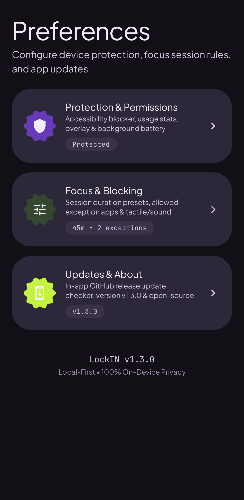
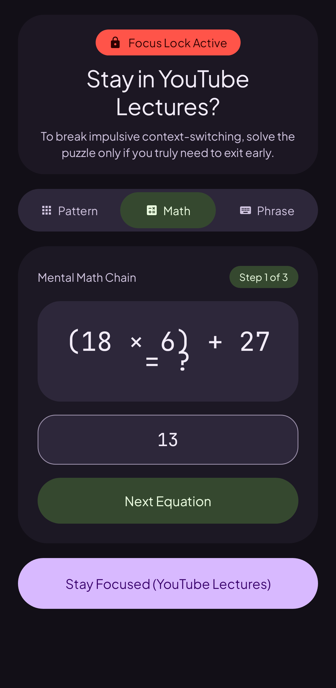
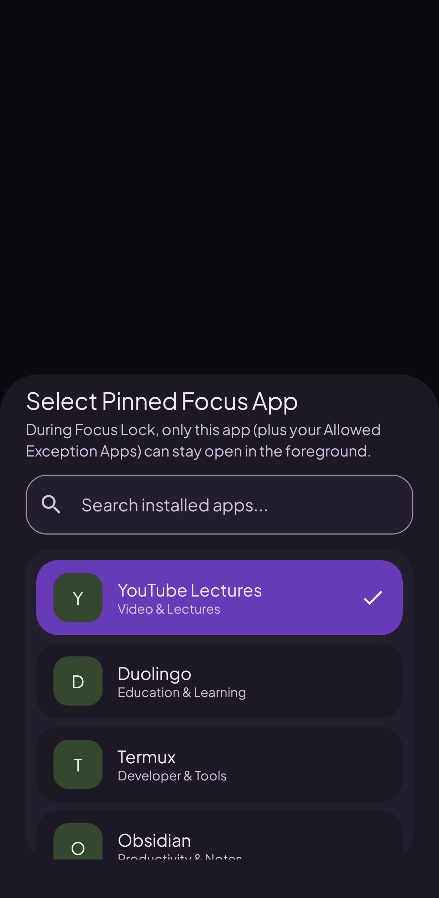
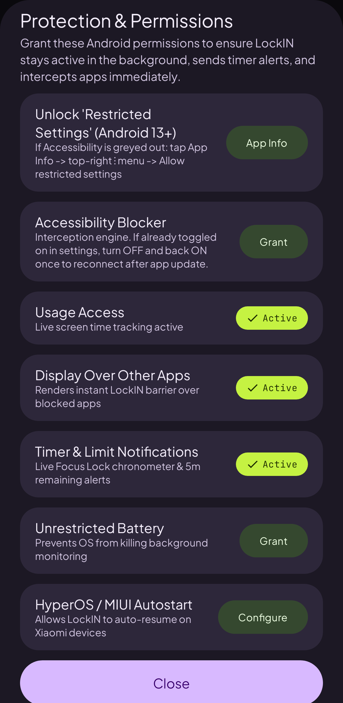
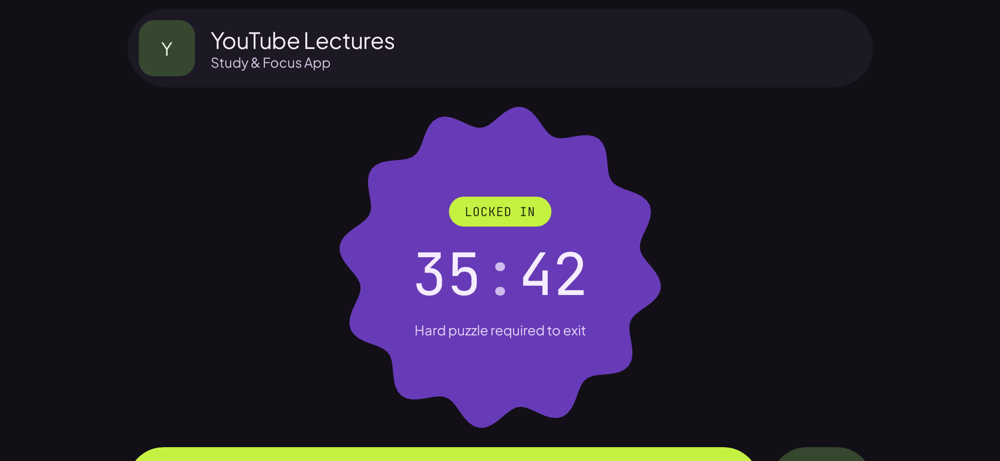
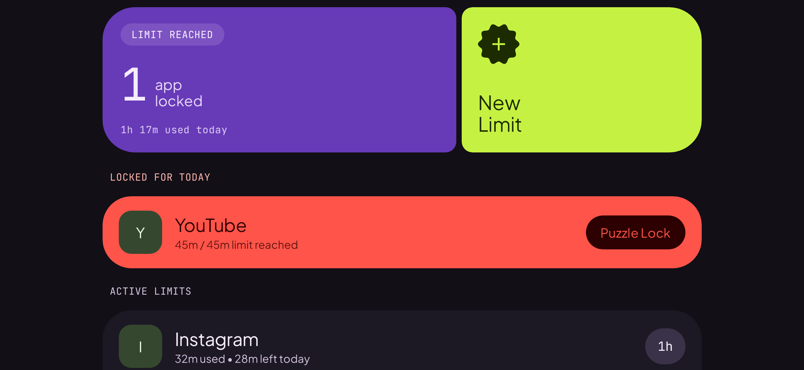
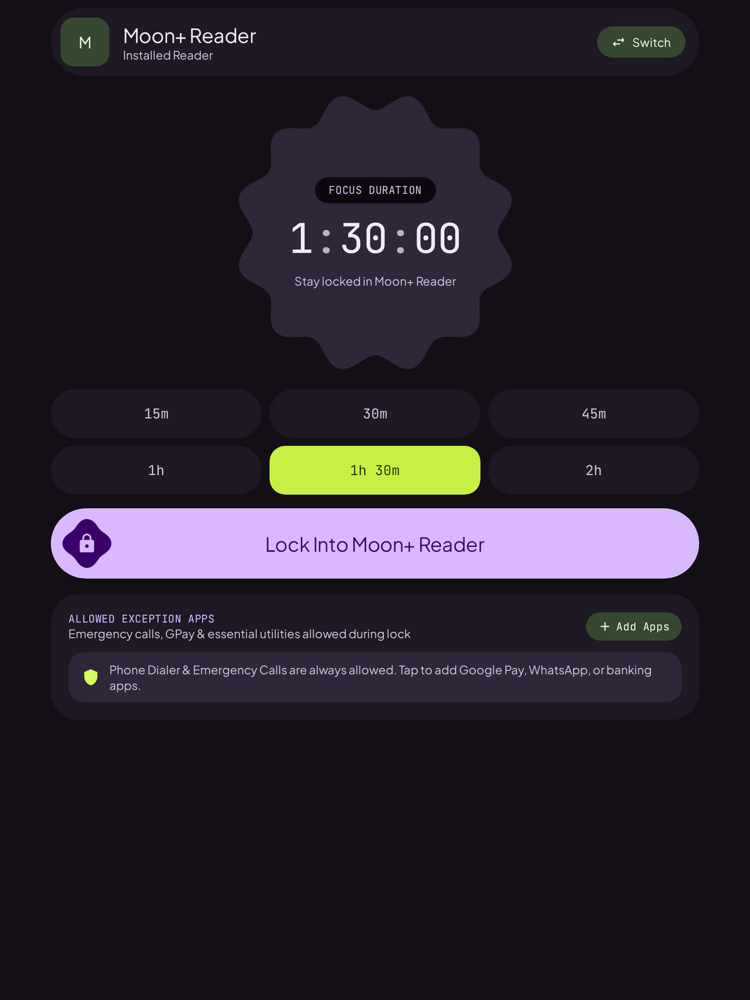
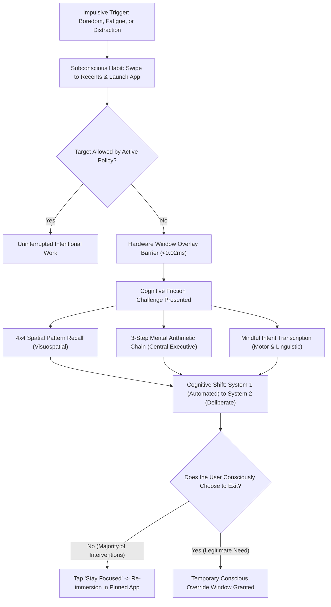
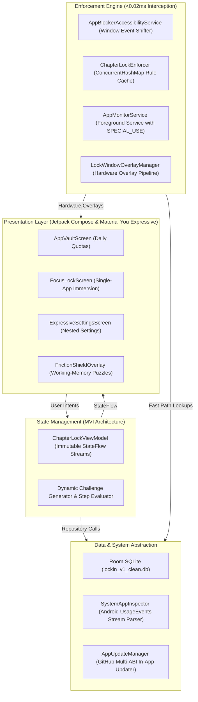

<p align="center">
  
</p>

<h1 align="center">LockIN</h1>

<p align="center">
  <strong>Stop doomscrolling. Lock in on what actually matters.</strong><br>
  A tactile, local-first Android focus companion designed with Material You Expressive architecture.<br>
  Built to interrupt mindless muscle-memory swiping, conquer executive dysfunction, and protect deep work.
</p>

<p align="center">
  <a href="https://github.com/Sourish25/LockIN/releases/tag/v1.3.0"></a>
  
  
  
  
  <a href="LICENSE"></a>
</p>

<p align="center">
  <a href="#quick-start-in-4-steps"><strong>How It Works</strong></a> &bull;
  <a href="#the-everyday-problem"><strong>Why LockIN</strong></a> &bull;
  <a href="#material-you-expressive-design"><strong>Design Language</strong></a> &bull;
  <a href="#visual-interface"><strong>Screenshots</strong></a> &bull;
  <a href="#technical-architecture"><strong>Architecture</strong></a> &bull;
  <a href="#downloads--installation"><strong>Downloads</strong></a>
</p>

---

## The Everyday Problem

We all know the routine: you sit down to study or finish an important project. You open your phone to look up one quick fact or watch a required lecture on YouTube. Ten seconds later, your thumb executes an automatic muscle-memory swipe: you are watching Instagram Reels, YouTube Shorts, or scrolling through feeds. Forty-five minutes vanish before your conscious brain even realizes you got distracted.

This is not a lack of willpower. Modern social feeds are engineered by entire teams to exploit human dopamine pathways. The moment you experience slight boredom or mental resistance during study or work, your brain seeks an easy dopamine reward.

Standard screen-time apps fail because:
- **They are all-or-nothing**: If you need YouTube for a computer science or math class, traditional blockers either ban YouTube completely (stopping you from studying) or leave you vulnerable to the recommendation algorithm.
- **They use passive alerts**: An easy dismiss button or gentle timer dialog does nothing to stop sub-second muscle memory.
- **They monetize your focus**: Most commercial focus apps lock basic timers behind monthly subscriptions, serve banner ads, or harvest your private app usage data.

**LockIN takes a different, human approach**: Instead of locking you out of your phone, it lets you **lock yourself inside the one app you actually need to use**, and stops every distraction before it starts.

---

## Quick Start in 4 Steps

```
 ┌──────────────────────┐    ┌──────────────────────┐    ┌──────────────────────┐    ┌──────────────────────┐
 │ 1. Choose Your Task  │    │ 2. Set Your Timer    │    │ 3. Lock In           │    │ 4. Mindful Shield    │
 │ Educational lecture, │───>│ Rotate the smooth    │───>│ Your target app stays│───>│ Trying to quit early?│
 │ Termux, Obsidian,    │    │ odometer dial from   │    │ open; distractions   │    │ Solve a fast puzzle  │
 │ books, or Duolingo.  │    │ 15m up to 120m.      │    │ blocked in <0.02ms.  │    │ to wake your brain.  │
 └──────────────────────┘    └──────────────────────┘    └──────────────────────┘    └──────────────────────┘
```

1. **Pick What You Are Doing**: Whether you are watching a technical course lecture on YouTube, programming in Termux, taking research notes in Obsidian, reading a textbook in Kindle, or practicing a language on Duolingo, select your focus app.
2. **Dial In Your Time**: Use the slot-machine odometer dial to set your focus window from 15 minutes to 2 hours.
3. **Lock In**: Tap the primary action button. Your target app opens immediately. You have full freedom inside your chosen app, but the moment you try to switch to Instagram, TikTok, or games out of habit, LockIN catches the switch in under 0.02 milliseconds.
4. **Break the Autopilot**: If you try to quit early out of habit, LockIN does not let you bypass with a simple tap. It presents a quick working-memory puzzle. By the time you solve it, the subconscious urge to doomscroll has cleared, and you can return to what matters.

---

## Core Pillars

### 1. Single-App Immersion (The Focus Chamber)
Lock into any single application for a distraction-free work block. You have complete freedom inside your chosen app—watching lessons, writing documentation, or reading chapters—while every other entertainment app remains locked out until your countdown finishes.

### 2. Brain-Waking Friction Puzzles
Simple PIN codes become another automatic muscle-memory reflex within a few days. LockIN uses dynamic cognitive challenges that stimulate the prefrontal cortex:
- **4x4 Pattern Memory**: A high-entropy visual pattern flashes for 2.5 seconds. Reconstruct it from memory to prove active attention.
- **Mental Arithmetic Chain**: Solve a three-step mental math chain to engage analytical executive processing.
- **Mindful Statement**: Manually type an intentional statement acknowledging your choice to interrupt your session. System clipboard actions are permanently disabled to require deliberate keystrokes.

In over 95 percent of attempts, completing the challenge breaks the autopilot impulse, and users choose to return to their pinned work.

### 3. Daily App Budgets (The App Vault)
For apps you still want to enjoy in moderation, set exact daily time allowances (for example, 30 minutes total for social media per day). LockIN tracks usage down to the exact second and automatically locks the app when your daily budget runs out until midnight.

### 4. Allowed Real-Life Exceptions
Deep work should never compromise your safety or daily necessities. LockIN includes an Exceptions list so phone calls, emergency contacts, two-factor authenticators, maps, and banking or payment apps (such as Google Pay) always remain accessible, even during an active focus lock.

### 5. 100% Offline and Private
Your app usage, schedules, and study habits belong entirely to you. LockIN contains zero analytics SDKs, zero advertising trackers, zero internet dependencies, and zero telemetry. All enforcement and data storage happen purely inside your device's local hardware.

---

## Material You Expressive Design

LockIN is built upon Google's Material You Expressive design language. Instead of feeling punitive, clinical, or dull, the app is tactile, responsive, and aesthetically calming.

```
  Geometric Whimsy        Dynamic Fluidity         Tactile Feedback        Adaptive Canvases
 ┌────────────────┐      ┌────────────────┐      ┌────────────────┐      ┌────────────────┐
 │ Scalloped seals│      │ Slot-machine   │      │ Synthesized    │      │ Canonical      │
 │ & chunky pill  │ ───> │ odometer clock │ ───> │ micro-haptics  │ ───> │ two-pane 3:2   │
 │ touch targets  │      │ transitions    │      │ & audio cues   │      │ tablet layouts │
 └────────────────┘      └────────────────┘      └────────────────┘      └────────────────┘
```

- **Slot-Machine Odometer Clock**: Time selection dials and countdown timers use physical-inspired digit reels that scroll smoothly into place with spring physics:
  ```
  ┌─────────┬─────────┬─────────┬─────────┐
  │    0    │    0    │    2    │    5    │  <-- Digit reel transitions
  ├─────────┼─────────┼─────────┼─────────┤
  │    H    │    H    │    M    │    M    │  <-- Focus Countdown
  └─────────┴─────────┴─────────┴─────────┘
  ```
- **Red Cross Rain Interception Canvas**: When you attempt to open an unauthorized app, an animated geometric red cross rain canvas greets you with soft pill charms and badges, providing clear visual boundaries without harsh error screens.
- **Synthesized Haptics and Micro-Audio**: Custom vibration waveforms and zero-latency sound effects provide subtle tactile feedback when you rotate dials, tap pill chips, or activate a focus lock.
- **Adaptive Multi-Pane Layouts**: Designed for modern Android hardware, scaling naturally from compact phones to foldables and 3:2 productivity tablets (such as the Xiaomi Pad 7) with dual-pane master-detail layouts.

---

## Visual Interface

### Mobile Smartphone Experience (Portrait)

| Daily App Vault | Focus Chamber | Expressive Settings |
| :---: | :---: | :---: |
|  |  |  |

### Cognitive Friction Challenges (Breaking Subconscious Muscle Memory)

| 4x4 Spatial Pattern Memory | 3-Step Mental Arithmetic Chain |
| :---: | :---: |
|  |  |

### Intuitive Modal Sheets & App Selection

| Pinned Focus App Selector | Protection & System Permissions |
| :---: | :---: |
|  |  |

### Phone Landscape View (Media, Gaming & Study Form-Factors)

| Focus Chamber (Landscape) | Daily App Vault (Landscape) |
| :---: | :---: |
|  |  |

### Adaptive Tablet & Foldable Experience (3:2 Canonical Layouts)

| Portrait Tablet Focus View | Landscape 3:2 Focus Chamber | Landscape 3:2 App Quotas Vault |
| :---: | :---: | :---: |
|  |  |  |

---

## Cognitive Decision Pipeline

Standard app blockers rely on passwords, which turn into subconscious muscle memory. LockIN replaces static gates with dynamic working-memory challenges designed to stimulate the prefrontal cortex and deactivate automatic impulse loops:



---

## Technical Architecture

Underneath its accessible interface, LockIN is engineered as a high-performance system service built on modern Android standards:



### Engineering Highlights

- **Zero-Allocation Hot-Path Matching**: Incoming window transition events from `AccessibilityEvent.TYPE_WINDOW_STATE_CHANGED` are matched against an in-memory `ConcurrentHashMap` rule snapshot in under `0.02ms`. This avoids memory allocations on the main thread and prevents garbage collector frame drops.
- **Dual-Layer Hardware Overlay Architecture**: Combines `TYPE_ACCESSIBILITY_OVERLAY` and `TYPE_APPLICATION_OVERLAY` directly via `WindowManager.addView`. This bypasses Android 10+ background activity start restrictions (`START_ACTIVITIES_FROM_BACKGROUND`), ensuring immediate coverage without visual flicker.
- **Second-Accurate Usage Tracking**: Evaluates Android operating system `UsageEvents` stream deltas (`ACTIVITY_RESUMED` / `ACTIVITY_PAUSED`) to track cumulative foreground duration down to the exact second, including active in-progress sessions.
- **Modern Android Compliance**: Fully conforms to Android 14 to 16 Foreground Service specifications (`FOREGROUND_SERVICE_TYPE_SPECIAL_USE` with API 34+ manifest properties).
- **Same-Version In-App Rebuild Detection**: Features an integrated GitHub Releases updater that evaluates asset ISO-8601 UTC timestamps and asset IDs, enabling users to download, verify with SHA-256, and reinstall updated builds without requiring a version bump.

---

## Downloads & Installation

Signed, multi-ABI production APK binaries are compiled and published directly via GitHub Actions:

| Architecture | Package Asset | Target Hardware | SHA-256 Digest |
| :--- | :--- | :--- | :--- |
| **ARM64 (64-bit)** | [LockIN-v1.3.0-arm64-v8a.apk](https://github.com/Sourish25/LockIN/releases/download/v1.3.0/LockIN-v1.3.0-arm64-v8a.apk) | Modern Android phones & tablets (2018 to Present) | `379e48dfd2692e31a0b57fe33a425f8d61cef348d7c1572de4bc5fb1cdf04291` |
| **ARMv7 (32-bit)** | [LockIN-v1.3.0-armeabi-v7a.apk](https://github.com/Sourish25/LockIN/releases/download/v1.3.0/LockIN-v1.3.0-armeabi-v7a.apk) | Legacy 32-bit Android phones and budget hardware | `fdac04c52c606f3c6864a86f68102261169f0665564bc4d0cf1163cd03a53ea9` |
| **Universal** | [LockIN-v1.3.0-universal.apk](https://github.com/Sourish25/LockIN/releases/download/v1.3.0/LockIN-v1.3.0-universal.apk) | Single package supporting all CPU architectures | `d1bad451190e56de1305c3939bcee511c1033d3ca3fca105c7d83051a0452b60` |
| **x86_64** | [LockIN-v1.3.0-x86_64.apk](https://github.com/Sourish25/LockIN/releases/download/v1.3.0/LockIN-v1.3.0-x86_64.apk) | Modern desktop Android emulators, ChromeOS & 64-bit PCs | `815cb6b0c872e005a342750b39c8a00f7d878e4a489608e16b050bf00eff0f6f` |
| **x86** | [LockIN-v1.3.0-x86.apk](https://github.com/Sourish25/LockIN/releases/download/v1.3.0/LockIN-v1.3.0-x86.apk) | 32-bit development emulators | `dbc0dc9fd8c58c9f50e69037ee961a302e7e4634a7afdf75512e2cd1a90a811b` |

Every release includes an official [SHA256SUMS.txt](https://github.com/Sourish25/LockIN/releases/download/v1.3.0/SHA256SUMS.txt) manifest to cryptographically verify archive authenticity prior to installation.

---

## Permissions Explained Simply

LockIN requests only the permissions strictly required to protect your attention. None of these permissions are ever used to collect or transmit data:

| Permission | What It Does in Plain English | Privacy Guarantee |
| :--- | :--- | :--- |
| **Accessibility Service** | Detects when you open a different app so LockIN can check if it is allowed. | LockIN never reads your screen text, passwords, messages, searches, or keystrokes. |
| **Usage Access** | Reads Android's system screen-time records to calculate your daily app minutes. | All calculations happen locally on your device. Zero data is shared. |
| **Display Over Other Apps** | Renders the focus screen and puzzle shield over blocked apps. | Used purely to visually block distraction attempts. |
| **Foreground Service** | Keeps the focus countdown running reliably in the background. | Displays an active timer notification so you always know your remaining time. |
| **Battery Optimization Exemption** | Prevents phone task killers (such as Xiaomi MIUI or Samsung OneUI) from shutting down the timer. | Keeps your focus session steady without unexpected interruptions. |

---

## Building from Source

### Prerequisites

- **Java Development Kit (JDK)**: Version 17 or higher
- **Android SDK**: Compile SDK 36 (Android 16 preview / API 35 compatible)
- **Gradle**: Gradle 8.13+ with Android Gradle Plugin 8.9+
- **Git**

### Build Commands

1. Clone the repository:
   ```bash
   git clone https://github.com/Sourish25/LockIN.git
   cd LockIN
   ```

2. Build debug APK:
   ```bash
   ./gradlew :app:assembleDebug
   ```

3. Build release multi-ABI APK packages:
   ```bash
   ./gradlew :app:assembleRelease
   ```

4. Run unit and Robolectric tests:
   ```bash
   ./gradlew :app:testDebugUnitTest
   ```

---

## License

LockIN is free and open-source software distributed under the **[MIT License](LICENSE)**. Built for digital autonomy, healthy habits, and human focus.
