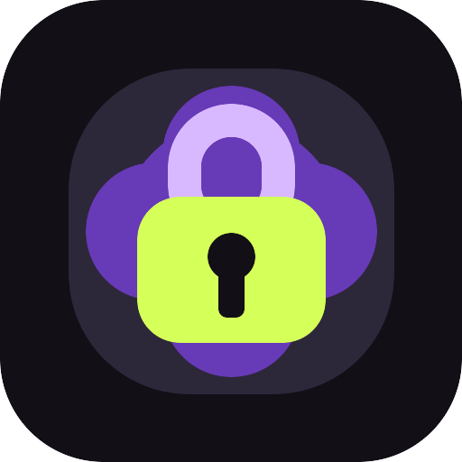
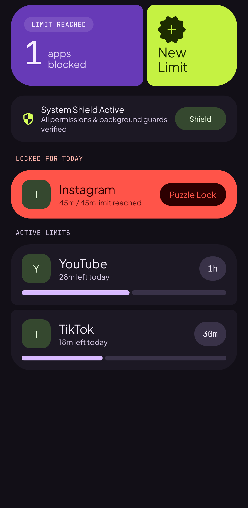
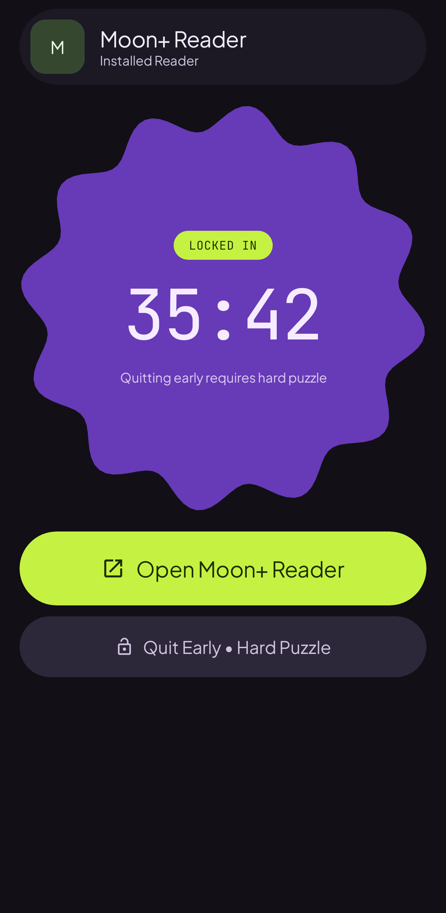
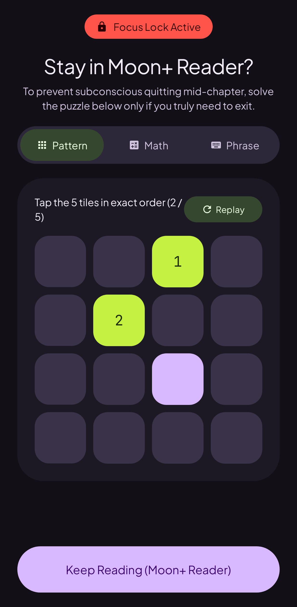
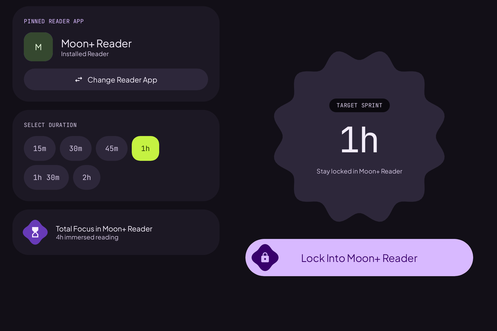

<p align="center">
  
</p>

<h1 align="center">LockIN</h1>

<p align="center">
  Open source Android screen time limiter and single-app reading focus lock built with Kotlin, Jetpack Compose, and Material 3 Expressive.
</p>

## Overview

LockIN is a local-first Android utility built for people with ADHD and heavy readers who want to read light novels, e-books, or long-form articles without subconsciously switching to social media or short-form video apps. Most commercial app blockers rely on ads, telemetry, or recurring subscriptions. LockIN is completely free, open source, offline, and free of tracking.

LockIN focuses on two core workflows:

1. **Daily App Limits**: Assign a daily minute allowance to any installed distraction app on your device. Usage is tracked through Android `UsageStatsManager` (`queryAndAggregateUsageStats` and `UsageEvents`). Once an app reaches its daily budget, LockIN intercepts launch attempts and blocks access for the remainder of the day.
2. **Single-App Focus Lock**: Select an installed reader or productivity app (such as Moon+ Reader, Mihon, ReadEra, Kindle, or Lithium) and start a timed session. While the session is active, attempting to leave the reader to open an unapproved app triggers an immediate interception barrier.

If you need to quit a focus session early or request a temporary 10-minute emergency pass for a blocked app, LockIN requires solving a multi-stage cognitive friction puzzle (a 4x4 sequential memory grid, a 3-step mental arithmetic chain, or deliberate phrase typing with copy-paste disabled). This breaks automatic muscle-memory app switching while keeping you in full control of your device.

## Screenshots

All screenshots below are rendered directly from the Jetpack Compose UI layer.

| Daily App Limits | Focus Lock Mode | Cognitive Friction Shield |
| :---: | :---: | :---: |
|  |  |  |

### Tablet and 3:2 Display Layout

LockIN includes a responsive two-pane canonical layout with a persistent navigation rail optimized for tablets and 3:2 reading displays (such as the Xiaomi Pad 7).

<p align="center">
  
</p>

## Architecture and Technical Highlights

* **Zero-Allocation Hot Path Interception (`ChapterLockEnforcer`)**: Window state transitions in `AppBlockerAccessibilityService` are evaluated against an in-memory `ConcurrentHashMap` cache in under 0.02ms without blocking the main thread or performing disk I/O.
* **Self-Sufficient Background Enforcement**: Both `AppBlockerAccessibilityService` and `AppMonitorService` synchronize state directly with the local Room SQLite database (`lockin_v1_clean.db`). Rules and active sessions remain enforced even if the UI activity is swiped away from recents.
* **Reboot and Update Survivability (`BootReceiver`)**: Listens for `ACTION_BOOT_COMPLETED`, `QUICKBOOT_POWERON`, and `ACTION_MY_PACKAGE_REPLACED` to restore active timers and background guards automatically after a device restart.
* **Android 10 to 15 Background Activity Start Compliance**: Combines `GLOBAL_ACTION_HOME` with a high-priority `fullScreenIntent` notification channel so the friction puzzle shield appears reliably across modern Android versions.
* **No Preset or Mock Data**: Fresh installations start with an empty database and inspect only real launchable packages installed on the user's device via `PackageManager`.

## Releases and ABI Architecture Downloads

Starting with v1.0.0, release builds are split by CPU ABI so you can install the smallest native binary for your device. Check the GitHub Releases page for prebuilt APK downloads and `SHA256SUMS.txt` verification hashes:

* `LockIN-v1.0.0-arm64-v8a.apk`: Recommended for almost all modern 64-bit Android phones and tablets (ARMv8-A).
* `LockIN-v1.0.0-armeabi-v7a.apk`: For older 32-bit ARM Android devices (ARMv7-A).
* `LockIN-v1.0.0-x86_64.apk`: For 64-bit x86 tablets, Chromebooks, and Android emulators.
* `LockIN-v1.0.0-universal.apk`: Universal build containing all architectures in a single package.

## Required Android Permissions

LockIN operates entirely on-device and requests only the permissions required to measure screen time and intercept blocked apps:

1. **Accessibility Service (`BIND_ACCESSIBILITY_SERVICE`)**: Detects foreground window package changes (`TYPE_WINDOW_STATE_CHANGED`) so blocked apps can be intercepted immediately without high battery drain.
2. **Usage Access (`PACKAGE_USAGE_STATS`)**: Queries accurate daily foreground usage minutes from the operating system.
3. **Display Over Other Apps (`SYSTEM_ALERT_WINDOW`)**: Allows the cognitive friction puzzle screen to surface when a restricted app is opened.
4. **Unrestricted Battery and OEM Autostart**: On devices running Xiaomi HyperOS or MIUI, open the in-app Shield Setup sheet to enable Autostart and Unrestricted Battery so the system does not terminate background enforcement during long reading sessions.

## Building from Source

### Prerequisites

* JDK 17 or newer
* Android SDK Platform 36

### Build Commands

Assemble the debug APK:

```bash
./gradlew :app:assembleDebug
```

Assemble the multi-ABI split release APKs (`arm64-v8a`, `armeabi-v7a`, `x86`, `x86_64`, and `universal`):

```bash
./gradlew :app:assembleRelease
```

Run the unit and Robolectric test suite (which also regenerates the Compose screenshots in `docs/screenshots/`):

```bash
./gradlew :app:testDebugUnitTest
```

## License

LockIN is released under the MIT License. See the [LICENSE](LICENSE) file for full license text.
